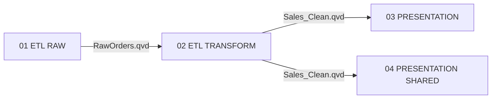
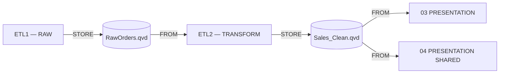

# QlikGPT — App Lineage & Impact Analysis

> Lineage **statico derivato dagli script QVS su GitHub**. Le dipendenze tra app sono inferite quando una scrive un QVD/file con STORE e un'altra legge lo stesso URI con FROM. Non è il lineage operativo rilevato dal tenant e non certifica l'ultimo reload né il contenuto del QVD.

## Mappa delle dipendenze tra applicazioni

## Data flow — applicazioni e QVD

## Applicazioni e input/output

| Applicazione | Script QVS | Legge | Produce |
| --- | --- | --- | --- |
| [QlikGPT - 01 ETL RAW](https://sdggroup-it.eu.qlikcloud.com/sense/app/932480d2-415d-4535-9267-c699f44c55c6) | [scripts/etl1.qvs](../scripts/etl1.qvs) | — | `RawOrders.qvd` |
| [QlikGPT - 02 ETL TRANSFORM](https://sdggroup-it.eu.qlikcloud.com/sense/app/70ba9d05-24b7-46ec-8b8c-560e8169c3d1) | [scripts/etl2.qvs](../scripts/etl2.qvs) | `RawOrders.qvd` | `Sales_Clean.qvd` |
| [QlikGPT - 03 PRESENTATION](https://sdggroup-it.eu.qlikcloud.com/sense/app/07dfa926-4895-4fb2-af4c-eac90e9eb2cb) | [scripts/presentation.qvs](../scripts/presentation.qvs) | `Sales_Clean.qvd` | — |
| [QlikGPT - 04 PRESENTATION SHARED](https://sdggroup-it.eu.qlikcloud.com/sense/app/04280b14-6ba5-4fe9-90d6-2ff8fa1c994f) | [scripts/presentation.qvs](../scripts/presentation.qvs) | `Sales_Clean.qvd` | — |

## Dipendenze dirette

| App sorgente | App dipendente | QVD o file condiviso | Evidenza QVS |
| --- | --- | --- | --- |
| [QlikGPT - 01 ETL RAW](https://sdggroup-it.eu.qlikcloud.com/sense/app/932480d2-415d-4535-9267-c699f44c55c6) | [QlikGPT - 02 ETL TRANSFORM](https://sdggroup-it.eu.qlikcloud.com/sense/app/70ba9d05-24b7-46ec-8b8c-560e8169c3d1) | `lib://DataFiles/QlikGPT/01_RAW/RawOrders.qvd` | [scripts/etl1.qvs](../scripts/etl1.qvs#L31) (STORE) / [scripts/etl2.qvs](../scripts/etl2.qvs#L14) (FROM) |
| [QlikGPT - 02 ETL TRANSFORM](https://sdggroup-it.eu.qlikcloud.com/sense/app/70ba9d05-24b7-46ec-8b8c-560e8169c3d1) | [QlikGPT - 03 PRESENTATION](https://sdggroup-it.eu.qlikcloud.com/sense/app/07dfa926-4895-4fb2-af4c-eac90e9eb2cb) | `lib://DataFiles/QlikGPT/02_TRANSFORM/Sales_Clean.qvd` | [scripts/etl2.qvs](../scripts/etl2.qvs#L36) (STORE) / [scripts/presentation.qvs](../scripts/presentation.qvs#L27) (FROM) |
| [QlikGPT - 02 ETL TRANSFORM](https://sdggroup-it.eu.qlikcloud.com/sense/app/70ba9d05-24b7-46ec-8b8c-560e8169c3d1) | [QlikGPT - 04 PRESENTATION SHARED](https://sdggroup-it.eu.qlikcloud.com/sense/app/04280b14-6ba5-4fe9-90d6-2ff8fa1c994f) | `lib://DataFiles/QlikGPT/02_TRANSFORM/Sales_Clean.qvd` | [scripts/etl2.qvs](../scripts/etl2.qvs#L36) (STORE) / [scripts/presentation.qvs](../scripts/presentation.qvs#L27) (FROM) |

## Impact Analysis — a valle di ogni app

Impatto **potenziale** della modifica o indisponibilità di un'app/del suo output. Il report non avvia reload e non sostituisce l'analisi delle modifiche alle misure del Semantic Catalog.

| Applicazione | Impatto diretto | Impatto indiretto | Totale a valle |
| --- | --- | --- | --- |
| [QlikGPT - 01 ETL RAW](https://sdggroup-it.eu.qlikcloud.com/sense/app/932480d2-415d-4535-9267-c699f44c55c6) | etl2 | presentation, presentation2 | etl2, presentation, presentation2 |
| [QlikGPT - 02 ETL TRANSFORM](https://sdggroup-it.eu.qlikcloud.com/sense/app/70ba9d05-24b7-46ec-8b8c-560e8169c3d1) | presentation, presentation2 | — | presentation, presentation2 |
| [QlikGPT - 03 PRESENTATION](https://sdggroup-it.eu.qlikcloud.com/sense/app/07dfa926-4895-4fb2-af4c-eac90e9eb2cb) | — | — | — |
| [QlikGPT - 04 PRESENTATION SHARED](https://sdggroup-it.eu.qlikcloud.com/sense/app/04280b14-6ba5-4fe9-90d6-2ff8fa1c994f) | — | — | — |

## Dettagli per applicazione

### QlikGPT - 01 ETL RAW

- **Qlik Cloud:** [QlikGPT - 01 ETL RAW](https://sdggroup-it.eu.qlikcloud.com/sense/app/932480d2-415d-4535-9267-c699f44c55c6)
- **Script:** [scripts/etl1.qvs](../scripts/etl1.qvs)
- **Upstream diretti:** Nessuno nel repository
- **Downstream diretti:** etl2
- **Downstream complessivi:** etl2, presentation, presentation2
- **Sorgente dati:** AUTOGENERATE 5000 (dati sintetici)
- **STORE (qvd):** `lib://DataFiles/QlikGPT/01_RAW/RawOrders.qvd` — [scripts/etl1.qvs](../scripts/etl1.qvs#L31)

### QlikGPT - 02 ETL TRANSFORM

- **Qlik Cloud:** [QlikGPT - 02 ETL TRANSFORM](https://sdggroup-it.eu.qlikcloud.com/sense/app/70ba9d05-24b7-46ec-8b8c-560e8169c3d1)
- **Script:** [scripts/etl2.qvs](../scripts/etl2.qvs)
- **Upstream diretti:** etl1
- **Downstream diretti:** presentation, presentation2
- **Downstream complessivi:** presentation, presentation2
- **Tabelle RESIDENT locali:** RawOrders
- **FROM (qvd):** `lib://DataFiles/QlikGPT/01_RAW/RawOrders.qvd` — [scripts/etl2.qvs](../scripts/etl2.qvs#L14)
- **STORE (qvd):** `lib://DataFiles/QlikGPT/02_TRANSFORM/Sales_Clean.qvd` — [scripts/etl2.qvs](../scripts/etl2.qvs#L36)

### QlikGPT - 03 PRESENTATION

- **Qlik Cloud:** [QlikGPT - 03 PRESENTATION](https://sdggroup-it.eu.qlikcloud.com/sense/app/07dfa926-4895-4fb2-af4c-eac90e9eb2cb)
- **Script:** [scripts/presentation.qvs](../scripts/presentation.qvs)
- **Upstream diretti:** etl2
- **Downstream diretti:** Nessuno
- **Downstream complessivi:** Nessuno
- **Tabelle RESIDENT locali:** FactSales
- **FROM (qvd):** `lib://DataFiles/QlikGPT/02_TRANSFORM/Sales_Clean.qvd` — [scripts/presentation.qvs](../scripts/presentation.qvs#L27)

### QlikGPT - 04 PRESENTATION SHARED

- **Qlik Cloud:** [QlikGPT - 04 PRESENTATION SHARED](https://sdggroup-it.eu.qlikcloud.com/sense/app/04280b14-6ba5-4fe9-90d6-2ff8fa1c994f)
- **Script:** [scripts/presentation.qvs](../scripts/presentation.qvs)
- **Upstream diretti:** etl2
- **Downstream diretti:** Nessuno
- **Downstream complessivi:** Nessuno
- **Tabelle RESIDENT locali:** FactSales
- **FROM (qvd):** `lib://DataFiles/QlikGPT/02_TRANSFORM/Sales_Clean.qvd` — [scripts/presentation.qvs](../scripts/presentation.qvs#L27)

## Ambito e limiti

- L'identificazione è basata su letture FROM e scritture STORE dichiarate nei QVS versionati. Per QVD con nomi dinamici, INCLUDE non tracciati, SQL/REST, trasformazioni complesse o altri data source occorrono adattatori aggiuntivi.
- Il collegamento tra URI DataFiles uguali **presuppone** che le app possano risolverli nello stesso spazio/percorso condiviso: la sola stringa lib:// non dimostra l'identità della risorsa se cambiano gli spazi.
- Oggetti o app creati manualmente fuori dal repository non compaiono automaticamente. Per le Presentation aggiunte via manifest, il report individua automaticamente lo script condiviso.
- Una dipendenza nel grafo esprime **potenziale propagazione** di una modifica ai dati, non una regola di scheduling: la CI attuale ha un processo di reload distinto.
- Il Semantic Catalog governa misure, dimensioni e variabili; la [mappa semantica](../catalog/USAGE.md) è complementare al presente lineage dei dati.

## Utilizzo

- [Grafo machine-readable](graph.json) per integrazioni e controlli.
- Analisi di una singola app: `python3 ci/app_lineage.py --app etl1`
- Rigenerazione (GitHub Actions): `python3 ci/app_lineage.py`
- Verifica che i report siano aggiornati: `python3 ci/app_lineage.py --check`
